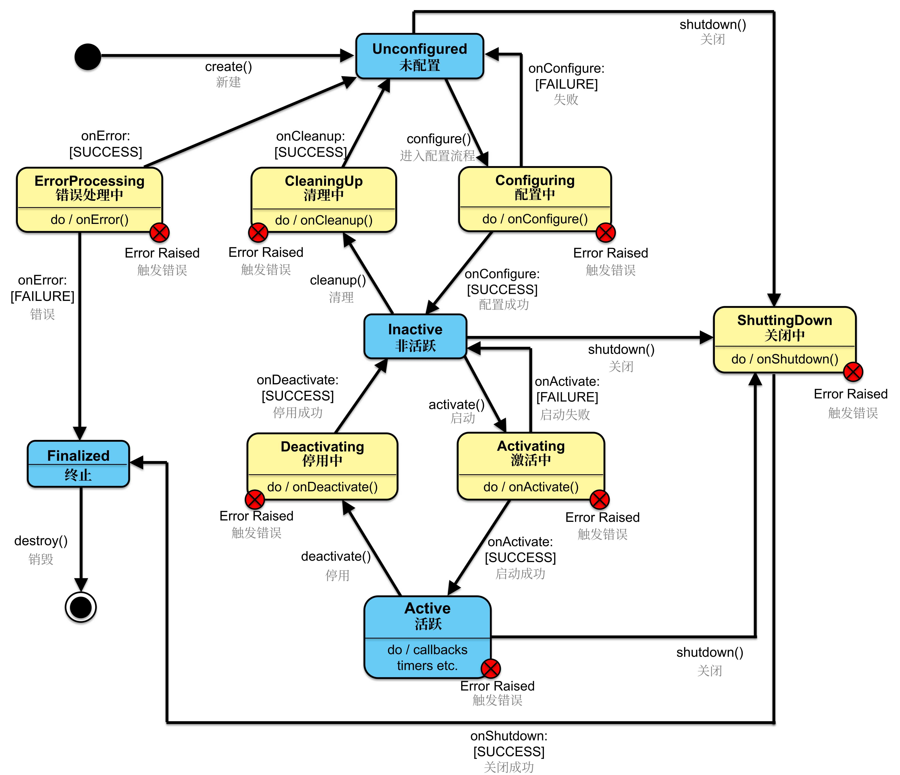
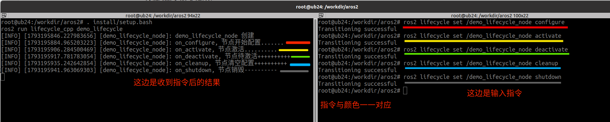
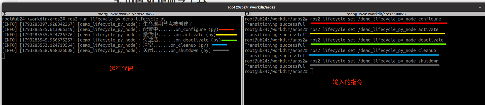

# 生命周期节点

## 1. 简介

### 1.1场景

> 在机器人运行时，需要根据任务需求动态激活或停用某些功能模块（如摄像头、激光雷达），以节省计算资源或能量损失。那么应该怎样实现呢？

在 ROS2 中提供了生命周期节点以实现上述功能。生命周期节点是一种特殊的节点，它在标准节点的基础上增加了一组预定义的状态和状态转换，使得节点能够更加可靠和可管理。

### 1.2 概念

生命周期节点是 ROS2 独有的。它是包含状态和转换的节点，用于 ROS2 服务的启动和关闭。这有助于 ROS 系统在启动和关闭时的确定性行为。

生命周期节点基于一个有限状态机，建议的节点生命周期状态机包括四个主要状态：

- **未配置（Unconfigured）**：

  节点初始状态。在此状态下，节点尚未完成初始化。

- **活跃（Active）**：

  节点正在活跃运行。在这一状态下，节点已完全激活并执行其主要功能。

- **非活跃（Inactive）**：

  节点未在活跃执行。这是从激活状态暂停到的状态，可用于临时暂停节点活动。

- **终止（Finalized）**：

  节点生命周期的终止状态。

有六个过渡状态，这些状态是在请求转换期间的中间状态：

- **配置中（Configuring）**
- **激活中（Activating）**
- **停用中（Deactivating）**
- **关闭中（ShuttingDown）**
- **清理中（CleaningUp）**
- **错误处理中（ErrorProcessing）**



其工作流程如下：

从节点的创建开始，此时节点处于未配置状态。在配置阶段，节点加载所需的设置和资源，成功后转移到非活跃状态。在非活跃状态，节点不执行任务，但可以安全地进行调整或重新配置，以备后续活动。当节点被激活时，它进入活跃状态，此时它开始处理数据、响应服务请求，并执行核心功能。如果在活跃状态中遇到无法内部解决的问题，节点将转入错误处理状态，在这里尝试恢复到稳定状态。节点的生命周期可通过优雅的关闭过程进入终结状态，之后节点被销毁。

###  1.3 作用

提供对节点状态的精确控制，确保节点按照预设的安全和可靠的方式运行。通过定义一系列状态和状态之间的转换，管理框架允许系统在节点初始化、激活、运行及关闭过程中进行详细监控和控制。这不仅增强了系统的稳定性和响应能力，而且通过状态管理简化了故障诊断和恢复过程，使得在发生错误时可以快速准确地回退到安全状态或重新配置，极大地提高了机器人系统的可维护性和可扩展性。此外，生命周期管理还支持系统的动态调整和资源优化，为复杂的机器人应用提供了必要的灵活性和效率。


## 2. 案例以及案例分析

### 2.1 案例需求

需求：编写一个ROS2的lifecycle Node，在终端中进行生命周期节点的切换。

### 2.2 流程简介

主要步骤如下：

1. 编写源文件；
2. 编译；
3. 执行。

案例我们会采用C++和Python分别实现，二者都遵循上述实现流程。

### 2.3 准备工作

终端下进入工作空间的src目录，调用如下两条命令分别创建C++功能包和Python功能包。

```bash
ros2 pkg create lifecycle_cpp --build-type ament_cmake --dependencies rclcpp rclcpp_lifecycle --node-name demo_lifecycle
ros2 pkg create lifecycle_py --build-type ament_python --dependencies rclpy --node-name demo_lifecycle_py
```


## 3. 生命周期节点之C++实现

### 3.1 编写源文件

功能包lifecycle_cpp的src目录下，新建C++文件demo_lifecycle.cpp，并编辑文件，输入如下内容：

```c++
//运行指令： ros2 run lifecycle_cpp demo_lifecycle 

/*
  需求：编写一个ROS2的lifecycle Node, 并执行。

  流程：
    1.包含头文件；
    2.初始ROS2客户端；
    3.创建一个生命周期节点类；
    4.执行生命周期节点对象；
    5.释放资源；
*/

// 1.包含头文件；
#include "rclcpp/rclcpp.hpp"
#include "rclcpp_lifecycle/lifecycle_node.hpp"

using CallbackReturn = rclcpp_lifecycle::node_interfaces::LifecycleNodeInterface::CallbackReturn;


// 3.创建一个生命周期节点类；
class MyNode: public rclcpp_lifecycle::LifecycleNode{
public:
  MyNode():LifecycleNode("demo_lifecycle_node"){
    RCLCPP_INFO(this->get_logger(), "demo_lifecycle_node 创建");
  }

  // 要重写转换过程相关的函数

  CallbackReturn on_configure(const rclcpp_lifecycle::State & previous_state){
    (void)previous_state;
    RCLCPP_INFO(this->get_logger(), "on_configure, 节点开始配置.......");
    return CallbackReturn::SUCCESS;
  }

  CallbackReturn on_activate(const rclcpp_lifecycle::State & previous_state){
    (void)previous_state;
    RCLCPP_INFO(this->get_logger(), "on_activate, 节点激活..........");
    return CallbackReturn::SUCCESS;
  }

  CallbackReturn on_deactivate(const rclcpp_lifecycle::State & previous_state){
    (void)previous_state;
    RCLCPP_INFO(this->get_logger(), "on_deactivate, 节点待激活++++++++++");
    return CallbackReturn::SUCCESS;
  }

  CallbackReturn on_cleanup(const rclcpp_lifecycle::State & previous_state){
    (void)previous_state;
    RCLCPP_INFO(this->get_logger(), "on_cleanup, 节点清空配置++++++++++");
    return CallbackReturn::SUCCESS;
  }

  CallbackReturn on_shutdown(const rclcpp_lifecycle::State & previous_state){
    (void)previous_state;
    RCLCPP_INFO(this->get_logger(), "on_shutdown, 节点销毁----------");
    return CallbackReturn::SUCCESS;
  }

};

int main(int argc, char ** argv)
{
  // 2.初始ROS2客户端；
  rclcpp::init(argc, argv);
  // 4.执行生命周期节点对象；
  auto mynode = std::make_shared<MyNode>();
  // mynode 是生命周期节点，而不是普通节点
  rclcpp::spin(mynode->get_node_base_interface());
  // 5.释放资源；
  rclcpp::shutdown();

}

```
### 3.2 编译

终端中进入当前工作空间，编译功能包：

```bash
colcon build --packages-select lifecycle_cpp
```

### 3.3 执行

当前工作空间下，启动两个终端，终端1执行发布程序，终端2执行订阅程序。

终端1输入如下指令：

```bash
. install/setup.bash
ros2 run lifecycle_cpp demo_lifecycle
```

终端2输入如下指令：

```bash
ros2 lifecycle set /demo_lifecycle_node configure
ros2 lifecycle set /demo_lifecycle_node activate
ros2 lifecycle set /demo_lifecycle_node deactivate
ros2 lifecycle set /demo_lifecycle_node cleanup
ros2 lifecycle set /demo_lifecycle_node shutdown
```

即可实现节点不同状态的转换。




## 4. 生命周期节点之Python实现

### 4.1 编写源文件

功能包lifecycle_py的lifecycle_py目录下，新建Python文件demo_lifecycle_py.py，并编辑文件，输入如下内容：

```python
"""
    运行指令：
        ros2 run lifecycle_py demo_lifecycle_py

    需求：编写一个ROS2的lifecycle Node, 并执行。

    流程：
        1.导包；
        2.初始 ROS2客户端；
        3.创建一个生命周期节点类；
        4.执行生命周期节点对象；
        5.释放资源；

"""
# 1.导包；
import rclpy
from rclpy.lifecycle import Node,TransitionCallbackReturn,State

# 3.创建一个生命周期节点类；
class MyNode(Node):
    def __init__(self):
        super().__init__("demo_lifecycle_py_node")
        self.get_logger().info('生命周期节点被创建了')

    # 编写状态转换函数实现
    def on_configure(self, state:State) -> TransitionCallbackReturn:
        self.get_logger().info('配置中.......on_configure (py)')
        return TransitionCallbackReturn.SUCCESS
    
    def on_activate(self, state:State) -> TransitionCallbackReturn:
        self.get_logger().info('激活中.......on_activate (py)')
        return TransitionCallbackReturn.SUCCESS
    
    def on_deactivate(self, state:State) -> TransitionCallbackReturn:
        self.get_logger().info('待激活.......on_deactivate (py)')
        return TransitionCallbackReturn.SUCCESS

    def on_cleanup(self, state:State) -> TransitionCallbackReturn:
        self.get_logger().info('清空.......on_cleanup (py)')
        return TransitionCallbackReturn.SUCCESS

    def on_shutdown(self, state:State) -> TransitionCallbackReturn:
        self.get_logger().info('关闭.......on_shutdown (py)')
        return TransitionCallbackReturn.SUCCESS

def main():
    #2.初始 ROS2客户端； 
    rclpy.init()
    # 4.执行生命周期节点对象；
    rclpy.spin(MyNode())
    # 5.释放资源；
    rclpy.shutdown()

if __name__ == '__main__':
    main()

```

### 4.2 编译

终端中进入当前工作空间，编译功能包：

```bash
colcon build --packages-select lifecycle_py
```

### 4.3 执行

当前工作空间下，启动两个终端，终端1执行发布程序，终端2执行订阅程序。

终端1输入如下指令：

```bash
. install/setup.bash
ros2 run lifecycle_py demo_lifecycle_py
```

终端2输入如下指令：

```bash
ros2 lifecycle set /demo_lifecycle_py_node configure
ros2 lifecycle set /demo_lifecycle_py_node activate
ros2 lifecycle set /demo_lifecycle_py_node deactivate
ros2 lifecycle set /demo_lifecycle_py_node cleanup
ros2 lifecycle set /demo_lifecycle_py_node shutdown
```



即可实现节点不同状态的转换。


## 5. lifecycle命令工具

`ros2 lifecycle` 用于查看和控制生命周期节点，其基本指令如下：

```text
nodes    输出所有生命周期节点
get      输出指定节点的当前生命周期状态
list     输出指定节点可执行的状态转换
set      请求指定节点执行状态转换
```

基本语法：

```bash
ros2 lifecycle get <节点名称>
ros2 lifecycle list <节点名称>

#常用状态转换如下
ros2 lifecycle set <节点名称> <转换名称>
```

`ros2 lifecycle set` 常用状态转换如下：

```bash
# unconfigured → inactive
ros2 lifecycle set /demo_lifecycle_node configure

# inactive → active
ros2 lifecycle set /demo_lifecycle_node activate

# active → inactive
ros2 lifecycle set /demo_lifecycle_node deactivate

# inactive → unconfigured
ros2 lifecycle set /demo_lifecycle_node cleanup

# 当前状态 → finalized
ros2 lifecycle set /demo_lifecycle_node shutdown
```

状态转换与回调函数的对应关系如下：

| 转换名称     | 状态变化                                   | 调用的回调函数    |
| ------------ | ------------------------------------------ | ----------------- |
| `configure`  | `unconfigured → inactive`                  | `on_configure()`  |
| `activate`   | `inactive → active`                        | `on_activate()`   |
| `deactivate` | `active → inactive`                        | `on_deactivate()` |
| `cleanup`    | `inactive → unconfigured`                  | `on_cleanup()`    |
| `shutdown`   | `unconfigured/inactive/active → finalized` | `on_shutdown()`   |

> `set` 只能执行当前状态允许的转换。可以先使用 `ros2 lifecycle list <节点名称>` 查看当前可执行的转换。


## 6. 小结

在ROS2中，一般节点（普通节点）和生命周期节点（Lifecycle Node）是两种不同的节点管理方式，它们的核心区别在于对节点生命周期的控制程度和自动化能力。以下是两者的关系与区别总结：

---

### 核心关系

1. 继承关系
   - 生命周期节点是普通节点的扩展，继承了普通节点的所有功能（如发布/订阅、服务调用等），并在此基础上增加了**状态机管理能力**。
   - 普通节点是生命周期节点的子集（生命周期节点可退化为普通节点，但反之不成立）。

2. 共存性
   - 两者可以在同一系统中同时存在，生命周期节点通常用于需要严格资源管理的组件（如传感器驱动、控制器），而普通节点用于简单任务（如数据转换、日志记录）。

---


### 关键区别

| 维度 | 普通节点 | 生命周期节点 |
|------|----------|--------------|
| 状态管理 | 无状态机，启动后立即运行，退出时销毁。 | 遵循状态机模型（`Unconfigured → Inactive → Active → Finalized`），支持状态转换。 |
| 资源控制 | 手动管理资源（如启动时初始化，退出时清理）。 | 自动管理资源（通过状态转换回调函数控制初始化、激活、停用、清理）。 |
| 启动方式 | 直接通过 `ros2 run` 或 Launch 文件启动。 | 需通过 Launch 文件或服务调用触发状态转换（如 `configure`、`activate`）。 |
| 适用场景 | 简单任务、一次性运行的节点。 | 需要动态控制、资源复用或高可靠性的组件（如硬件驱动、复杂算法模块）。 |
| 调试支持 | 依赖日志和手动调试。 | 提供状态转换日志和事件通知（如 `/transition_event` 话题）。 |

---


### 总结

- **普通节点**是ROS2的基础单元，适合简单任务。
- **生命周期节点**是普通节点的增强版，通过状态机实现更精细的资源管理和动态控制，适合复杂系统。
- 两者并非替代关系，而是根据需求选择或结合使用。

通过合理选择节点类型，可以显著提升ROS2系统的可靠性、灵活性和资源利用率。